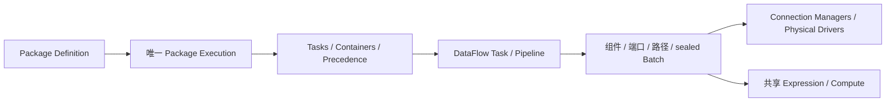

# UniversalData

纯 C17、可嵌入的数据集成 SDK，采用 SSIS 风格的 Package / Control Flow / Data Flow 分层。当前 `1.0.0` 是破坏性重构开发版本，ABI、Package、Schema、Plan、Wire、Plugin 和 Worker 协议为 3；不能加载 0.x 对象、包或检查点。



当前代码提供：不可变 Package、原生绑定与标量作用域、Sequence/For/Foreach、表达式优先约束、失败控制流、后台执行/取消/指标、多端口 Pipeline、有界队列、共享不可变 Batch、CSV/NDJSON/SQL 源、Derived Column、Conditional Split、Multicast、Union All、Cast、Sort/Join/Aggregate、文件及 SQL 目标、Connection Manager 和统一组件描述注册。组件与恢复的实际完成/验证状态见 [实施状态](docs/acceptance/ssis-status.json)，不能把源代码目录或旧 SDK 验收记录当作新架构验收。

SDK 仅保留 `ud_package` / `ud_execution` 执行链路。旧 CSV Job、DAG、Run 及其 .NET/Java 类已删除，没有兼容桥接。Query 复用数据与 Compute 内核；C# P/Invoke 和 Java JNI 只投影 native ABI。

## 构建

需要 CMake 3.25+、C17 编译器、Ninja；JNI 需要 JDK 17，语言包需要 .NET 8 和 Maven。

```sh
cmake --preset linux
cmake --build --preset linux --parallel 4
ctest --preset linux
# 可选 SQLite/PostgreSQL/ODBC/DuckDB 必须显式提供依赖，默认不下载。
# HTTP Task 可选：cmake --preset linux -DUD_WITH_HTTP=ON（需 libcurl >=7.85，TLS/异步 DNS）。
dotnet build examples/dotnet/Consumer.csproj
mvn -f bindings/java/pom.xml package
```

最小消费者只需 Foundation/Columnar；Package 静态组件自动选择 Expression/Compute/Runtime/Plugins。Windows 需支持 C17 的 MSVC；实际 Windows 验证状态独立记录。

原生 [HTTP Task](docs/architecture/http-task.md) 使用同一逻辑连接、宿主网络授权和凭据 resolver，强制 TLS 校验、禁用重定向并限制重试。HTTP Data Flow 源/目标仍为独立待办。

CLI：`ud_cli execute package.json '{}' tenant execution-id /authorized/root`。默认拒绝文件/数据库访问；SDK 宿主通过授权和凭据解析回调授予权限。Worker 为独立进程，不是权限沙箱。Java JAR 和托管 NuGet 包配合单独安装的同 ABI 原生库使用。

设计与边界：[产品](docs/product/product-model.md)、[架构](docs/architecture/target-architecture.md)、[SSIS 公开文档映射](docs/architecture/ssis-reference-matrix.md)、[破坏性变更](docs/breaking-changes.md)、[公共 ABI](docs/architecture/public-c-abi.md)、[路线图](docs/roadmap.md)。不声称 `.dtsx`/COM/SSISDB/SQL Agent 兼容；不提供默认 Web 管理平台或跨任意目标的全局 exactly-once。
