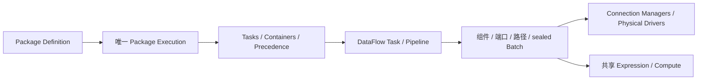

# UniversalData

UniversalData 2.0 正在 `codex/etl-ssis-product-alignment` / PR #6 开发，以 `main@7e706d28`（SDK 1.5.0 / ABI 9）为基线。C17 继续拥有唯一 Package / Execution / Component / Connector 执行体系；SDK 2.0.0 与 ABI、Package、Schema、Plan、Wire、Plugin、Checkpoint、Worker 协议族统一为 10。旧插件重新构建、旧包重新生成，旧恢复状态明确拒绝；原始数据与旧产物保留。

现有产品模型追踪全部 52 项审查：ETL-039（DQS）与 ETL-040（SSAS Data Mining）不适用，其余 50 项必须同时有当前源码与行为证据。三轮有界设计复核已纳入该模型。2.0 的 Linux 与 Windows 均要求验收；历史 ABI 9 的验收与 Windows 豁免不计入当前版本。当前连贯实现仍在进行，集中编译和验收尚未执行。

已落代码包括 Native 默认执行 ID 与宿主读取、[SQLite 索引 Catalog](docs/architecture/catalog.md)，以及 [PostgreSQL COPY / MySQL、MariaDB 受控远程原生装载](docs/architecture/sql-bulk-loading.md) 的追加模式。Upsert 暂存合并、BCP、OCI Direct Path、类型与恢复完整整改、ASP.NET Core 10 管理与 React Flow 设计器等仍按产品模型保持未完成状态。



当前代码提供：不可变 Package、原生绑定与标量作用域、Sequence/For/Foreach、表达式优先约束、失败控制流、后台执行/取消/指标、多端口 Pipeline、有界队列、共享不可变 Batch、CSV/NDJSON/SQL 源、Derived Column、Conditional Split、Multicast、Union All、Cast、Sort/Join/Aggregate、文件及 SQL 目标、Connection Manager 和统一组件描述注册。组件与恢复的实际完成/验证状态见 [实施状态](docs/acceptance/ssis-status.json)，不能把源代码目录或旧 SDK 验收记录当作新架构验收。

SDK 仅保留 `ud_package` / `ud_execution` 执行链路。旧 CSV Job、DAG、Run 及其 .NET/Java 类已删除，没有兼容桥接。嵌入式查询和 ETL 复用同一 Compute 算子；未来 BI planner 保留待实现状态；C# P/Invoke 和 Java JNI 只投影 native ABI。

## 构建

### Visual Studio 2026

安装 VS2026 的“使用 C++ 的桌面开发”（含 MSVC x64、Windows SDK、“适用于 Windows 的 C++ CMake 工具”）和“.NET 桌面开发”组件，并安装 .NET 8 SDK/目标包。VS2026 生成器需要 CMake 4.2+；构建入口优先使用当前 VS 实例自带的 CMake，没有内置 CMake 时使用 PATH 中的 CMake。

双击根目录的 `UniversalData.sln`，选择 `Debug | x64` 或 `Release | x64`，执行“生成解决方案”（Ctrl+Shift+B）。解决方案包含 `UniversalData.Native`、.NET SDK、`Consumer` 和 `DataConsumer`；原生项目先构建，再编译托管项目，并将对应配置的 `ud_data.dll` 复制到托管输出目录。

原生项目通过 Makefile 工程调用现有 CMake，支持源码浏览、IntelliSense、生成、重新生成与清理。CORE 明确构建原生 SDK 子集；产品宿主通过 `UD_BUILD_HOSTS=ON` 构建，要求 .NET SDK 10。PRODUCT 还要求全部驱动、Web 和语言依赖。JNI、SQLite/PostgreSQL、HTTP、测试和 benchmark 使用其他预设或显式配置启用。

原生产物位于 `build/vs2026/<Debug|Release>/ud_data.dll`，CLI/Worker 位于 `build/vs2026/hosts/product/<cli|worker>/`；托管 SDK 和示例位于各项目的 `bin/x64/<Debug|Release>/net8.0/`。原生构建完整日志保存在 `%TEMP%/UniversalData-vs2026/`，失败时输出真实退出码及错误摘要。默认原生启动项目为 CLI，调试前在项目属性中填写执行参数。

在 VS2026 Developer PowerShell 中也可编译完整解决方案：

```powershell
MSBuild.exe UniversalData.sln /restore /m /p:Configuration=Debug /p:Platform=x64 /nologo /verbosity:minimal
MSBuild.exe UniversalData.sln /restore /m /p:Configuration=Release /p:Platform=x64 /nologo /verbosity:minimal
# 独立编译原生项目（自动查找 VS2026），也支持 -Action Rebuild 或 Clean。
powershell.exe -NoProfile -ExecutionPolicy Bypass -File scripts/build-vs2026.ps1 -Action Build -Configuration Debug
```

`build/vs2026` 为专用构建目录。切换 VS 安装实例导致缓存冲突时，确认路径后仅删除该目录，再生成解决方案。`Clean` 清理当前配置的产物，`Rebuild` 清理并重新编译当前配置。

### 其他构建方式

通用预设需要 CMake 3.25+、C17 编译器；Windows 预设需要 CMake 4.2+ 和 VS2026，Ninja 预设需要 Ninja。现有 `windows`/`linux` 预设启用 JNI，需要 JDK 17；.NET 绑定需要 .NET 8 SDK，Java 包需要 Maven。

```sh
cmake --preset windows
cmake --build --preset windows --parallel 4
ctest --preset windows
# 2.0 要求 Windows 与 Linux 均验收
cmake --preset linux
cmake --build --preset linux --parallel 4
ctest --preset linux
# 可选 SQLite/PostgreSQL 必须显式提供依赖，默认不下载。
# HTTP Task 可选：cmake --preset linux -DUD_WITH_HTTP=ON（需 libcurl >=7.85，TLS/异步 DNS）。
dotnet build examples/dotnet/Consumer.csproj
mvn -f bindings/java/pom.xml package
```

最小消费者只需 Foundation/Columnar；Package 静态组件自动选择 Expression/Compute/Runtime/Plugins。Windows 需支持 C17 的 MSVC；2.0 的 Linux 与 Windows 均须编译和验收。

原生 [HTTP Task](docs/architecture/http-task.md) 使用同一逻辑连接、宿主网络授权和凭据 resolver，强制 TLS 校验、禁用重定向并限制重试。HTTP Data Flow 源/目标仍为独立待办。

CLI：`ud_cli execute host-policy.json package.json '{}'`。SDK 未提供的新执行 ID 由 Native 生成；CLI 将原状态目录保存在 Native Catalog，恢复时使用 `ud_cli execute host-policy.json package.json '{}' ORIGINAL_ID resume`。CLI、Worker 与管理服务共用宿主资源范围、凭据引用及固定 C# 程序集加载入口。产品宿主使用 .NET 10，默认管理地址为 `127.0.0.1:5080`。Java JAR 使用同一发布物内的 JNI 和原生库；数据库连接器由宿主显式加载。

管理服务要求登录和显式租户策略。首次部署使用 `ud_cli identity-init IDENTITY_FILE SUBJECT TENANT` 初始化宿主身份目录；参考 [宿主身份与隔离契约](docs/product/hosting-security.md) 和 [策略示例](products/host-policy.example.json)。作业和执行记录只保存受保护参数引用；不可信扩展必须由可用的操作系统沙箱运行。

## Linux 产物交付

完成 Release/JNI 构建后，打包脚本直接安装已构建的二进制，生成 native NuGet、JAR/POM、SHA256 清单及 ZIP：

```sh
python packaging/package-linux.py --build build/four-engines-linux --output artifacts/2.0.0/linux-x64
python tests/installed_sdk.py --bundle artifacts/2.0.0/UniversalData-2.0.0-linux-x64.zip --work /tmp/ud-sdk-consumer-fresh --evidence artifacts/linux-consumers.json
python benchmarks/four_engines.py --cli build/four-engines-linux/hosts/ud_cli --output artifacts/linux-benchmark.json
```

输出目录和消费目录必须不存在。PostgreSQL 模块为显式可选项，要求 libpq 17+，使用可取消非阻塞命令/游标；每次复用清理 Session 状态。窗口、浮点 SUM、恢复与事务组合的实际边界见权威产品账本。Windows 本轮豁免，以下构建方式保留为平台说明。

## Windows 产物交付

唯一 facade target 为 `ud_data`，文件名为 `ud_data.dll`。在启用 JNI、hosts 和所需连接器的构建目录配置完成后运行：

```powershell
./packaging/package.ps1 -BuildDirectory build/windows
ctest --test-dir build/windows -C Release --parallel 4 --output-on-failure
$consumerWork = Join-Path $env:TEMP ('ud-sdk-consumer-' + [guid]::NewGuid().ToString('N'))
python tests/installed_sdk.py --bundle artifacts/UniversalData-1.2.0-win-x64.zip --work $consumerWork --evidence artifacts/consumers.json
```

脚本重新构建 Release，然后生成 `artifacts/2.0.0/win-x64/sdk`、带 Windows DLL 的 NuGet、Java JAR/POM、逐文件 SHA256 清单及 `artifacts/UniversalData-1.2.0-win-x64.zip`。已存在的同版本交付不会自动覆盖。长日志写入临时目录。独立消费测试只使用 ZIP 解压后的头文件、CMake exports、DLL、连接器和语言包，C# 执行时不添加 SDK 的加载路径。

原生 Windows 消费需要 x64 Microsoft Visual C++ Runtime；C# 需要 .NET 8，Java 需要 JDK 17。Linux 使用同一核心源码和算子；本轮交付与验收 Linux 二进制，Windows 豁免。

当前权威 [Phase 0–7 产品和技术设计](docs/architecture/phase-0-7-design.md)、[核心与扩展清单](docs/product/component-catalog.md)。

设计与边界：[产品](docs/product/product-model.md)、[架构](docs/architecture/target-architecture.md)、[SSIS 公开文档映射](docs/architecture/ssis-reference-matrix.md)、[破坏性变更](docs/breaking-changes.md)、[公共 ABI](docs/architecture/public-c-abi.md)、[路线图](docs/roadmap.md)。不声称 `.dtsx`/COM/SSISDB/SQL Agent 兼容；不提供默认 Web 管理平台或跨任意目标的全局 exactly-once。

四引擎本轮设计与追踪：[产品模型](docs/product/etl-four-engine-product-model.md)、[目标架构](docs/architecture/etl-four-engine-target.md)、[运行决策](docs/architecture/etl-runtime-decisions.md)、[删除矩阵](docs/architecture/etl-destructive-migration.md)、[78 项工作项与 69 目标同源映射](docs/acceptance/etl-four-engine-traceability.md)。`ud_cli inspect host-policy.json package.json` 读取原生绑定计划；`ud_execution_diagnostics` / `.NET Execution.Diagnostics()` / `Java Execution.diagnostics()` 返回统一运行事实。
