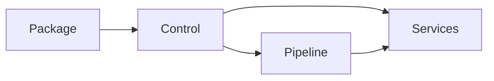

# ADR 0001：唯一 Package 执行核心

决策：删除 ud_job/ud_run/ud_dag 公开执行链路，ABI 升至 3。Control Flow 与 Data Flow 在唯一 Package Runtime 下分责；不建立 adapter，不保留新旧并行产品入口。

原因：旧 Job 与 Run 拥有不同状态、取消、恢复、输入模型。桥接只能掩盖两套成功与提交语义。Query 保留纯数据算子调用，但所有共享算法下移 Compute。

轨迹：同 Package 的 Sequence→For→DataFlow 不启动第二 Run，复用执行上下文。失败均由 Package 判定。代价是消费者与持久文档不向后兼容；迁移失败返回 Incompatible，不能读旧 checkpoint 猜测进度。

归属：package/control-flow/data-flow、公共 ABI 及绑定。判据：旧导出/语言类/协议搜索为空，三语言只调用新 Package。
