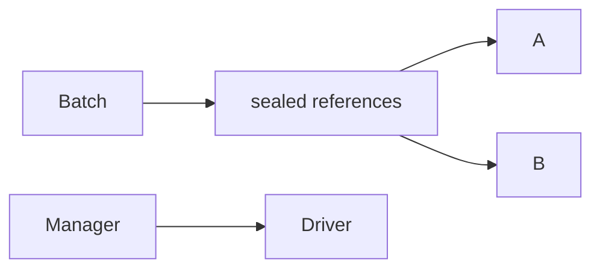

# ADR 0002：共享不可变 Buffer 和单层物理驱动

决策：唯一 ud_batch 引用所有权；sealed 后 append 拒绝；同步输出 retain，异步创建新 Batch。不要另建 PipelineRow，不隐式 COW。Manager 持逻辑配置，driver 持物理连接，不增加语义桥接。

轨迹：Multicast 两目标消费同 Batch，最后引用释放；需改值的 Derived 新分配 Batch。授权撤销导致下一驱动操作失败并释放 lease。代价：callback 必须遵守 emit/borrow 生命周期；内存 quota 同时覆盖 shared state 和异步输出。

归属：data/columnar、contracts、connectors、data-flow；引用泄漏和跨上下文 Batch 都是 ABI 错误，不通过无界 clone 掩盖。
