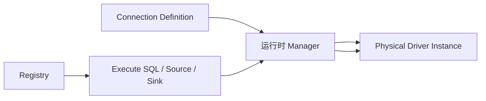

# Connection Manager 与组件插件

逻辑定义只有 id、driver、resource、credentialReference、scope、policy；Manager 解析作用域、授权和凭据并管理租用/释放；Driver 实现物理协议，不再实现另一套业务连接模型。文件与数据库都必须经过 Manager 授权。Package/Project 共享定义按名字查找，游标和事务实例不可被不兼容的并发任务共享。

Registry 使用一份版本化描述表，类别 Task/Source/Transform/Destination/Function；Connection、Enumerator、LogProvider 的未实现类别拒绝注册；同 ID/version 重复拒绝。描述与 callback user 在 Registry 生命周期内有效，Execution 持快照/租用，存在活动实例时不允许卸载。公开头 opaque 句柄；第三方不得 include internal.h。配置 Schema 不包含秘密值；凭据解析只返回 host-allocator 对象，用后释放。

能力 Read/Append/Upsert/Delete/Overwrite/Transaction/Snapshot/CDC/Discover/Receipt 明确声明，缺少能力返回 Unsupported；Execute SQL 与 Source 使用相同逻辑 Manager，不在组件配置复制连接字符串。SQLite/PostgreSQL 首批；ODBC/DuckDB 旧原型已删除，当前扩展为 Planned，SQL Server/MySQL/Excel/SFTP/Kafka 明确 Planned。

轨迹：授权 OPEN→resolver→Driver acquire→授权 READ/WRITE→执行→release；回调撤权后每次操作拒绝。失败或取消释放游标、连接、插件租用。宿主高权限 Task 没有 callback/allow flag 则拒绝；不将 exec shell 或 HTTP 作为默认能力。归属 connectors/、components/contracts/、plugins/。
