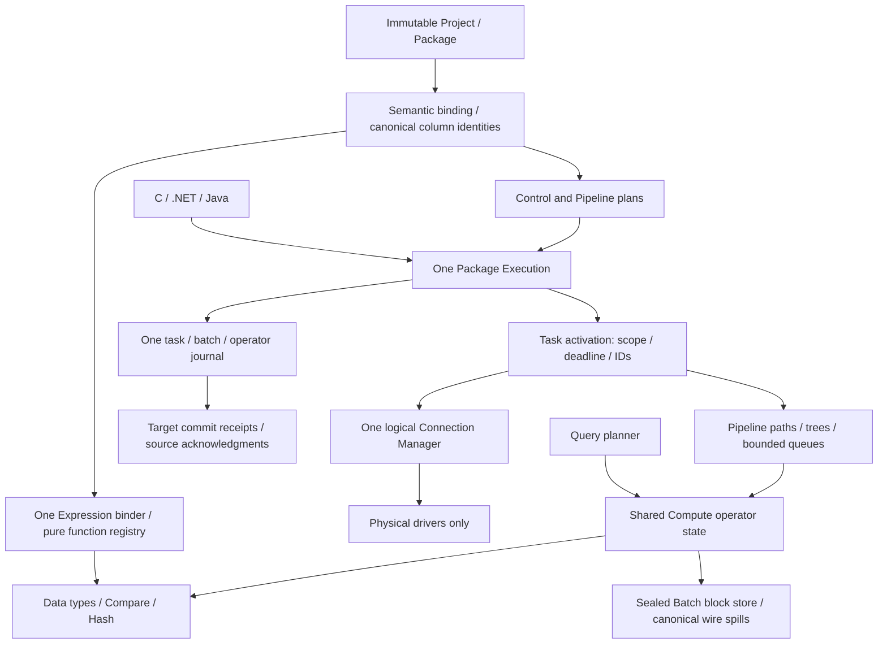

# Phase 0–7 convergence contract

This is the implementation contract for the user's 2026-10-12 instruction: destructive changes are authorized, compatibility bridges are forbidden, design reasoning precedes implementation, and compilation/acceptance happens only after all Phase 0–7 code is complete. The 69-item completion ledger remains the scope. This document does not mark planned work as implemented.

## Product behavior

A host selects one immutable Project/Package revision, supplies parameters and scoped resource grants, and starts one Execution. Control Flow activates Tasks; a DataFlow Task binds and runs a Pipeline in that Execution. A result is a terminal state plus its reason, committed target evidence and source progress. Partial target commits remain visible in a failed execution; neither a retry label nor a successful event handler converts that result to success.

A field has a display name, stable column identity, exact value type and origin identities. Renaming changes the display name. Deriving or copying a column creates a distinct output identity with the appropriate origins. Schema/type mismatch is diagnosed before resources are acquired. Expressions, ETL, Query, profiling and quality all use the same field rules, Compare/Hash, NULL semantics and conversion policy.

Hosts can inspect capability/configuration/port/resource metadata before execution. Unsupported capabilities are visible at binding. C, .NET and Java consume the same native Package and native schema/AST, with the same result and error classes. Language SDKs do not infer types, build alternate plans or implement fallback operators.

## Dependency and ownership

| Responsibility | Canonical code owner | Required removal/replacement |
|---|---|---|
| Exact field metadata, identity/origins, equality modes, Arrow/wire | `components/data` | Name-only binding and separately inferred field semantics |
| AST binding, type/result metadata, pure functions and permissions | `components/expression`, `components/contracts` | Context-specific expression parsers/function evaluators |
| Sort/Group/Join/Lookup/window state and partitioning | `components/compute` | Query-private external algorithms and Pipeline-private blocking accumulation |
| Block retention, memory/queue/spill budgets and cancellation | `components/execution` | Format-specific spill stores and unbounded operator buffers |
| Task scopes, local deadlines, activation identities | `engines/control-flow` | Global mutable current-task scope as a parallel execution context |
| Paths, End, emit ownership, fair scheduling and Error Output | `engines/data-flow` | Separate quality execution branches and driver-specific scheduling |
| Definitions/grants/credentials/lease ownership | `connectors/manager.c` | Generic plugin SQL paths used as alternate Connection Managers |
| Physical cursor/write/receipt/CDC capabilities | `plugins` | Driver-local schema conversion that contradicts Data semantics |
| Durable task/batch/operator/source/target history | `engines/package/checkpoint.c` | Independent checkpoint/state side files outside the journal contract |
| Metadata/module ownership across every category | `components/contracts` | Unleased callbacks or per-language registries |
| Version/deployment/history/audit views | `catalog` | Catalog execution authority or mutable artifact revisions |

## Decisions that must be implemented together

1. **Schema and values.** Identity is plan metadata, never derived from row contents or memory addresses. Source identities are deterministic in their definition namespace. Origins are a bounded, canonical set. Identity is preserved by forwarding, filtering, sorting and representation-preserving rename; a new computed/copied output has a new identity and origins. Port compatibility, physical value compatibility and exact schema equality are explicit Data operations. A Join may accept equal key value types with different identities, while an input batch must match its bound port schema. Arrow/wire/schema JSON preserve identities recursively; comparison/hash ignore identities and display names.
2. **Expression binding.** Resolve names once to bound fields/slots. Keep exact Decimal/temporal/recursive result metadata and dependency identities. Pure function descriptors and module ownership use the same registry. Permissions restrict which functions a context can bind. Function evaluation cannot acquire a connection or perform an external effect. Constant folding is allowed only for deterministic, pure operations with the same runtime error rules.
3. **Blocking operators.** Use one stateful Compute operator interface for batched and streamed callers. A bounded block store retains sealed Batch references or writes canonical wire blocks through an authorized temporary-resource lease. Sort uses stable run order and bounded merge; Group uses the shared key hash plus collision Compare; Join defines duplicate ordering, NULL keys, skew partitioning and bounded draining. Pipeline and Query select these operators and resource policies; they do not own a second algorithm. Public file-format APIs may only be codec/plan consumers of these operators, or must be deleted.
4. **Resource and activation scopes.** Root Execution owns global accounting and cancellation. Each task activation owns lexical scope, identities, local deadline and child cancellation, and borrows the root services. A local timeout cannot silently cancel an unrelated sibling. Concurrent writes to a common variable/physical transaction are rejected or explicitly ordered by the bound plan; shared immutable parameters are safe. Callback IDs and Journal keys come from activation context, not shared mutable `current` fields.
5. **Ports and rejection.** Normal, rejected and quarantined rows travel through the same bounded Scheduler. A rejected row has a documented typed diagnostic record including rule/column identity and source position. Fail-fast, reject and quarantine policies differ in target acknowledgment, not in the execution model. An uncommitted quarantine batch never advances source progress.
6. **Commit and resume.** Source progress is acknowledged after every required target outcome is proved. Operator checkpoints persist typed state and owned spill identities/checksums in the same Journal. Driver write+receipt is one target transaction. File publication uses the same staging/commit intent and content proof. Interrupted non-idempotent effects become CommitUnknown. Unsupported durable snapshots/acknowledgments are rejected before running with recovery enabled. There is no claim of a distributed transaction across independent destinations.
7. **Native contract and migration.** There is one current complete ABI/layout/protocol family. All bundled drivers, plugin descriptors, JNI/PInvoke layouts, hosts and examples are migrated in the same module when the contract changes. Old versions/layouts are rejected and old code paths are removed. A new forwarding alias to an old contract is not an acceptable migration.

## Phase dependency order and component catalog

Phase 0's executor removal is retained. Phase 1 implements canonical field identity/result metadata, value semantics and the unified registry/AST/resource contract. Phase 2 consumes activation scopes for containers, precedence, tasks, timeouts and events. Phase 3 consumes the shared operator/block contract for paths, trees, bounded scheduling, asynchronous state and Error Output. Phase 4 registers the file/SQL, mapping, comparison, sort/group/join/lookup, pivot and quality component catalog. Phase 5 persists their state/commits and completes Catalog/observability. Phase 6 projects the final ABI into actual installed C/NuGet/Maven consumers. Phase 7 extends the same registry/operators/drivers with SCD, fuzzy/term, CDC, partition/window/BI, protocol transports and columnar files; it cannot create another execution core.

The authoritative catalog remains `docs/acceptance/completion-goal.json` G00–G68 and `docs/product/component-catalog.md`. SQL Server/ODBC, MySQL, SFTP, Kafka, RabbitMQ, cloud objects, Excel and Parquet/Arrow require real relevant capability evidence. Mock protocol responses or compilation do not complete a connector. Microsoft-specific optional compatibility boundaries remain explicit.

## Reasoning checks before implementation

Trace: two equal Decimal/UTC/NaN keys with different source identities bind to the same value semantics, travel through different input ports, match only after Hash plus Compare, produce new Join output metadata and drain under the same budget. A copied output retains its origins without duplicating an identity in one output schema. Wire spill/reload changes neither key equality nor origin identity.

Failure trace: memory budget denies a block, spill authorization denies disk acquisition, or output rejects a row. The operator reports the appropriate error without consuming an unacknowledged source position; the Scheduler disposes opened instances once in reverse order. A target commit followed by process termination is resolved by its receipt/content proof, not by a stale in-memory task flag. A resumed spill with an incompatible schema/plan/checksum is rejected.

Concurrency trace: two ready Tasks borrow the same immutable Package but have separate activation IDs/scopes/deadlines. Event and journal writes preserve a deterministic sequence. Root cancellation reaches both; a local timeout reaches its activation. A callback cannot unload its module or mutate the Registry while Execution leases exist.

These traces expose the remaining architectural work: current Query external code and Pipeline blocking buffers still own separate state paths, identity is absent from fields, the function catalog is incomplete, and global activation fields prevent safe concurrent Tasks. The current draft is an intermediate development state; those paths must converge before the full goal is complete.

## Implementation and acceptance cadence

Implement the complete Phase 0–7 contracts and all affected callers before starting compilation or behavior verification. Inspect design/dataflow/ownership/recovery logic while writing; do not substitute repetitive builds for reasoning. Commit functional source modules promptly to the existing draft PR, recording final verification as NotRun. Once every Phase has its required source implementation, perform one centralized compile and the key behavior/sanitizer/install-consumer/integration gates. Expand or rerun only for a diagnosed failure or changed code. Final integration covers all nine attachment gates plus the declared component catalog. Existing test logs remain historical development evidence and do not establish the final source revision. Windows and remote CI status remain waived by the user's reconfirmed instruction; no Windows pass is claimed.
