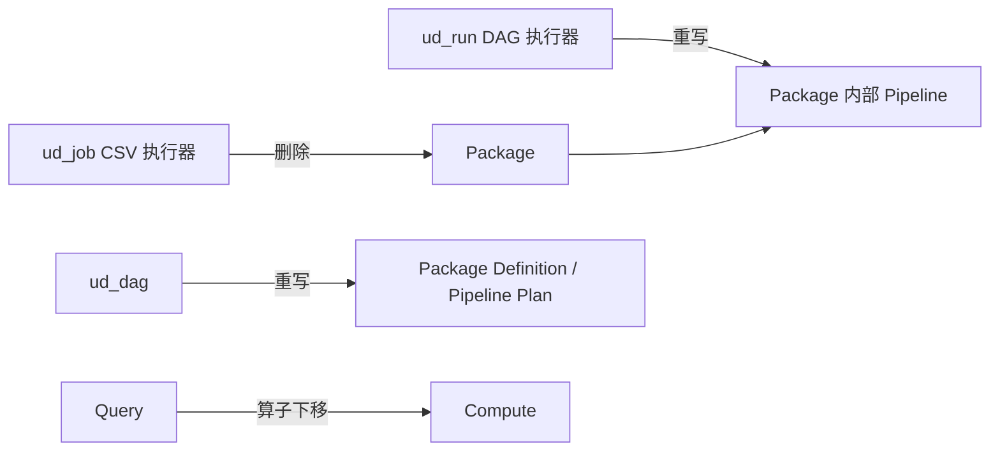

# 现有架构问题及破坏性处置矩阵

基线 ed3237a；实际读源码后决策。已删除旧 Job/Dag/Run 执行器、公开头、语言类及旧 CLI/Worker 调用；剩余迁移/扩展状态见 ssis-status.json。

| 旧模块/概念 | 实际职责 | 冲突 | 决策 | 新归属 | 完成标准 |
|---|---|---|---|---|---|
| engines/etl/src/etl.c / ud_job | CSV 目录、累计状态、独占锁、代次提交 | 独立 Context/状态/恢复入口 | 删除执行器；保留平台原子发布、codec 原语 | package/checkpoint、file driver | 无 Job 入口/绑定/测试 |
| engines/etl/src/run.c / ud_run | DAG 队列、独立上下文/线程、文件节点 | 与 Job 竞争；单输出；没有 Control | 重写 | data-flow + package/runtime | 无独立 Pipeline 启停句柄 |
| engines/etl/src/dag.c / ud_dag | 结构图、端口拓扑、参数替换 | 混用 Package 与管道模型 | 重写模型/保留验证算法思路 | package/model + data-flow/planner | Control 与 Path 分离 |
| quarantine.c | 隔离文件原子存储 | 专用确认链路 | 合并隔离目标到正常 Path/提交服务 | plugins/destinations | Error Output 与正常 Pipeline 同调度 |
| query.c/external*.c | Sort/Join/CSV/NDJSON spill | 算法属于 Query，ETL 无法直接复用 | 算子下移 Compute；文件入口改 Pipeline | components/compute | ETL/Query 调同一函数 |
| compute.c/mapping/regex/quality | 比较、聚合、转换、NFA/规则 | 文本计划不覆盖统一表达式 | 保留内核、重构表达式入口 | compute/expression | 单一 NULL/hash/cast |
| columnar/arrow/wire/types | 列式数据/递归类型/序列化 | Buffer 无共享所有权和列 identity | 保留内核并演进 | data | refcount/seal/lineage tests |
| contracts/plugin.c | loader+connection wrapper | 注册类别不足、逻辑定义缺失 | 拆规范 Registry 与 Manager | contracts/connectors | 默认拒绝，活动租用阻止卸载 |
| hosts/cli.c/worker.c | Job CLI 与 Query/Plugin 单次协议 | 两套面向用户入口 | 重写 Package CLI/Worker | hosts | 一个 Package 协议 |
| CsvJob/Dag/Run C#/Java + JNI | 各旧执行器薄封装 | 用户可选择竞争执行器 | 删除并重写 Package/Execution | bindings | 同文档、同 native 执行 |
| recovery.py/run*.py/dag.c 等旧测试 | 旧专属契约 | 会迫使保留旧路径 | 新契约重写；保留内核测试 | tests/package/pipeline/recovery | 核心语义门禁可追溯 |

失败场景：代码迁移只移动文件且仍存在旧状态机即不通过；中间 draft 提交允许暂未完成，但不得发版。Broken Changes 列明确旧名称/新名称/不兼容 wire。任何恢复证据必须新执行链路运行，旧 CSV 通过不计新 Package 通过。
