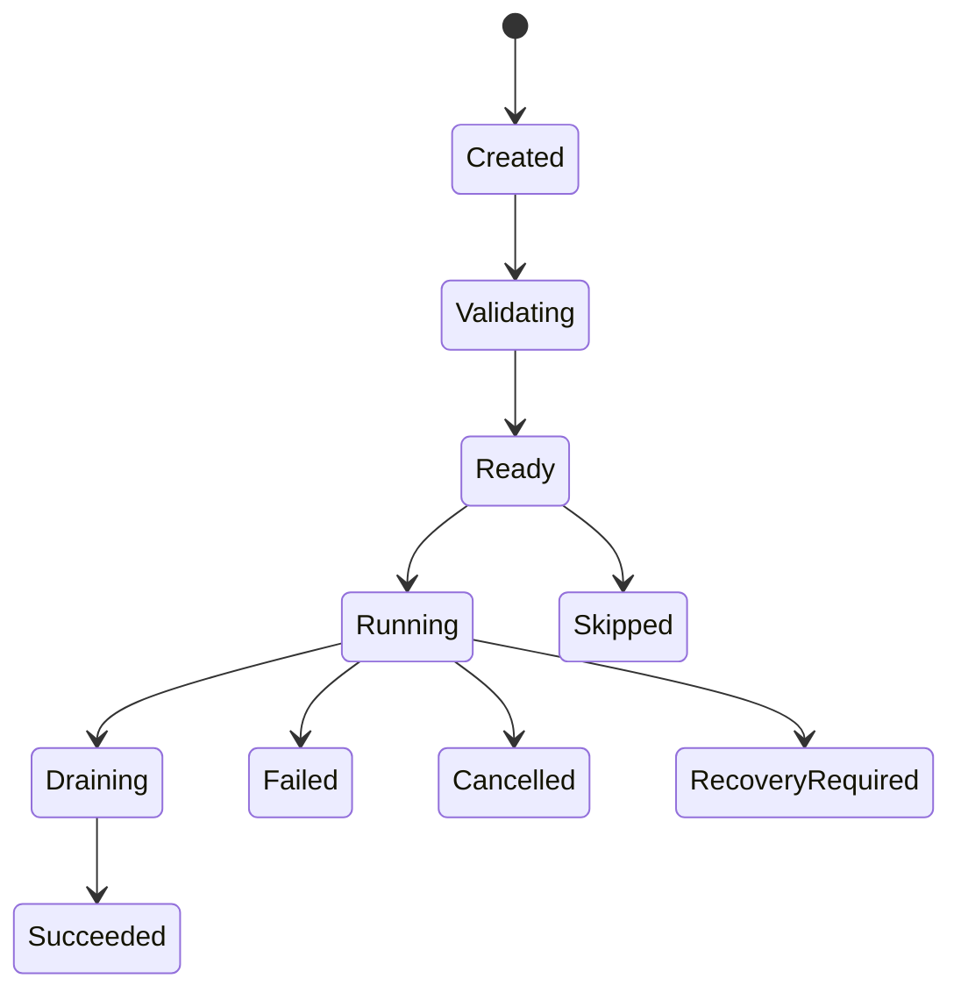

# Package 执行模型

一个 Execution 持有不可变 Package、参数快照、变量作用域栈、授权回调、Registry 快照、资源上下文、原子取消、Task/Pipeline 状态和指标。所有业务回调在执行线程调用；一个控制器执行/start/wait/destroy，cancel/metrics 可跨线程。回调不得重入启动/等待/销毁；宿主 user 指针活到执行结束。

Control Flow 每层先验证依赖无环与同层引用；按 AND/OR 组合 Success/Failure/Completion 和 expression 条件。Skipped 前驱不等于成功。无可运行且非终态节点是模型错误；失败沿约束传播，Failure 分支运行不能抹除失败。Sequence、For、Foreach 每次建立子作用域，计数与动态条件受迭代和深度限制。Task 超时是执行服务的 deadline，合作式 I/O 必须支持取消；不能把不合作插件描述为硬实时。

DataFlow Task 持一个或多个 Pipeline 实例，但不创建 ud_run。物理计划分割 Execution Trees；初期受限并发度可为 1，定义和预算不得假装已并行。后台线程属于 Package Execution，不属于每个节点。ExecutePackage 复用上下文和配额，父取消传播，递归深度受限。

失败轨迹：Prepare 节点 3 失败→节点 2、1 逆序 Dispose→Task Failed→Failure handler→Package Failed。外部线程 cancel→回调观察取消→流停止→队列/连接释放→Cancelled。归属 engines/package/runtime.c、engines/control-flow/control.c。
