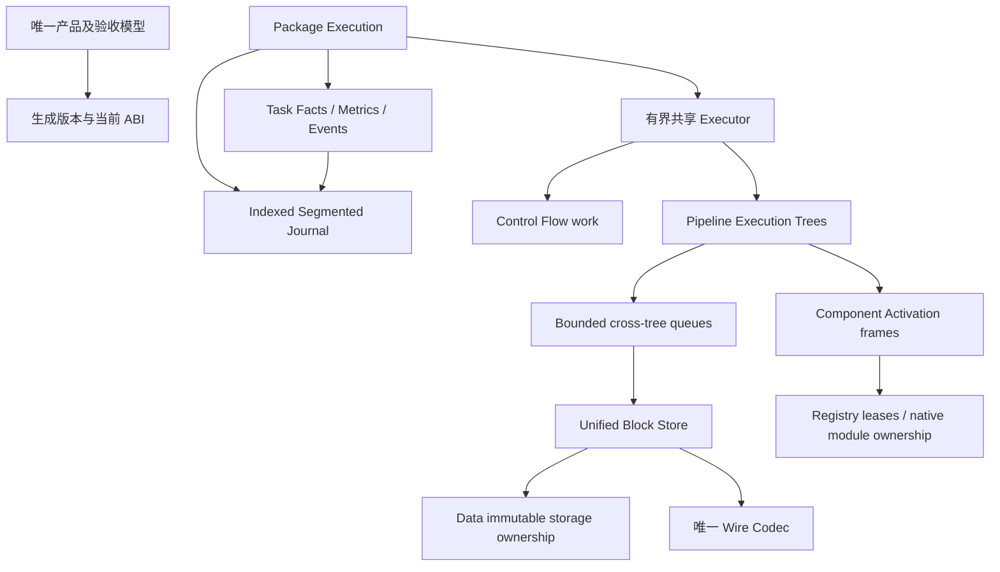

# 基础设施统一整改设计

基线：`ce72a2ce6ba41c4ee0a3b33a95a36ae59b7d3a39`，已在 GitHub main。实施分支：`codex/ssis-infrastructure-convergence`。本轮覆盖复查报告的六个基础问题；高级连接器、CDC/SCD/Fuzzy 和 BI Planner 继续保留真实待实现状态。Windows 集中编译和关键验收；Linux 的同一实现及平台支持保留，本轮免测。

## 已确认的问题与边界

| 对象 | 当前代码事实 | 替换范围 |
|---|---|---|
| Registry | 正式枚举包含三个被注册器无条件拒绝的类别；查找与 discovery 用链表 | 只公开实际支持的五类描述符；按 ID 索引、稳定 discovery、原子注册及模块所有权 |
| Block Store | resident 判定前总是分配完整 wire 并 hash；resident 使用 wire 长度 | Data 的不可变存储清单；按实际 SDK 分配计量和共享所有权；只在 spill/交换时编码 |
| Pipeline | tree 只作标识；一个线程遍历全部组件；组件身份写共享 Activation | 显式物理树、树内单一执行者、跨树有界队列、独立组件帧；使用 Package 共享执行基础设施 |
| Journal | 按 key 线性扫描；每个 record 一个文件；缓存分配发生在持久写入后 | 按 kind/key 索引的分段日志；提交帧、批量追加、原子快照及回收；拒绝损坏和不确定尾部 |
| Task metrics | 逻辑成功后先增 completed，再尝试持久完成 | 单一 task fact 转换：执行完成、持久确认、恢复待确认；事件和指标由同一转换产生 |
| Acceptance | 三个 JSON 重复维护状态；旧 ABI 描述与 merged 布尔值失实 | 一个版本/目标/门禁/交付模型；其他文件生成或校验，历史证据带来源且不等于当前验收 |

以上为源码事实；本轮尚未测量改造前后的吞吐量，不能据此宣称固定倍数的性能收益。

## 三次设计反思

1. **计量必须跟随真实所有权。** 同一 sealed Batch、多路扇出、Projection 和共享 Schema 可以引用同一分配。按每个 block 重复计费或者使用 wire 长度均不等于驻留容量。Data 提供只读存储访问清单；Block Store 对唯一分配维护引用计数，包含 allocation header、capacity、metadata 和嵌套列。不能遍历成行值后重新构造另一份“内存大小”模型。
2. **并行不能共享可写身份或产生第二个 Runtime。** 每棵树在同一时刻只有一个执行者，组件有独立 Activation 身份，参数/作用域在 step 阶段稳定。Configure/Prepare 和完成后的 Finish/Dispose 有明确边界。Control Flow 与执行树共用一个有界 executor 和根取消/期限/资源服务；阻塞的树让出工作，根预算不足时仍运行同一物理计划。队列和 End 的跨线程可见性必须一起更改。
3. **持久与内存事实必须按同一提交边界推进。** Journal 分配、解析和索引容量在持久写入前准备。每个完整提交帧才更新索引和持久确认事件；写入/flush 结果不明保留 CommitUnknown。逻辑成功不等于持久确认。快照发布成功并同步目录后才能回收旧段；恢复不得猜测截断记录的结果。

## 对象、生命周期和依赖

### Registry 与插件

- 当前正式类别为 Task、Source、Transform、Destination、Function。删除尚无生命周期的 Connection、Enumerator、Log Provider 枚举；Connection Manager 继续使用已有 typed connector contract，不能伪装成可注册 Pipeline 对象。
- 每个类别完整校验合法端口、回调、纯函数属性及不属于该类别的字段；未知类别拒绝。
- 注册批次先完成 metadata/ID/schema 校验、内存分配和 owner retain，再一次性发布。失败不留下半批条目；成功 owner retain 必须恰好 release 一次。
- discovery 的序号按注册顺序稳定；ID 查找使用索引。运行期 lease 冻结注册表；模块引用由 Registry 所有权保留至最后使用者释放。

### Block Store

- sealed 数据和 schema 的存储容量由 Data 定义，禁止下游复制其布局推算。驻留 store 只 retain，不生成 wire，不扫描行值，不 hash 内容。
- 所有 resident 分配按地址去重、引用计数；重复 store 和 Projection 扇出按新增独占分配计费。未 seal 或跨 Context 拒绝。
- Spill 仍只使用唯一 wire；受授权、Context quota、spill quota 和显式 working budget 约束。驻留预算与活动读/编码工作集分别可观察，不能将逻辑 wire 长度称为进程 RSS。
- 活动读取使用显式 view lease，保证 rehydration 所有权及计量可释放；有 reader 的 block 返回 Busy 并保留句柄；其他 release 结果消费句柄，失败删除转移至 manager 的 cleanup 列表，在 destroy 时重试。取消后仍可清理由管理器创建的文件；没有授予磁盘权限时保持 Resource/Auth。

### Executor 与 Execution Tree

- 共用一个根 worker budget 和 work group 机制，控制任务和数据流树使用同一执行基础设施；删除 Control Flow 自己的线程创建/计数分支。
- 异步组件产生新树；同步输入沿现有树延伸，合流约束以物理依赖为准。树保存节点列表、依赖边、状态及调度事实。
- 一次 work quantum 公平推进所属树，阻塞时释放调度所有权；同一树不被两个 worker 同时执行。单线程配置也通过这个模型执行。
- 每个组件有独立只读身份帧；根资源、取消、期限、Journal 和 Registry 共享。跨树队列负责容量、引用、End 顺序和可见性；所有输出可接收时才消费输入，失败后统一清理未消费数据。
- Configure/Prepare 完成后启动树工作；全图成功 drain 后按拓扑调用 Finish，变量写入和目标完成仍位于这个明确边界。失败/取消不伪造成功 drain；回收前等待全部 work 离开。

### Journal、Task Facts 与恢复

- `kind/key` 索引保存当前有效事实；批次事实带 task owner，用持久 task 完成事实回收其已无重放用途的临时批次索引。
- 日志为有大小上限的 segment，帧含版本、序号、前序 digest、记录集合、长度与 digest。一次 append 可以持久提交多个关联记录；禁止按记录建文件。
- 持久快照保存有效索引和链锚点；manifest 与持久尾部确认记录原子发布并同步目录。恢复先读快照，再按段顺序检查尾部并构建索引；持久尾部确认锚点不在日志链、缺段、hash/长度/身份错误或不完整帧均明确失败。
- 分段轮换及快照压缩不更改外部提交语义；旧段只在新 manifest 已持久确认后回收。保留有限上一代快照用于完整性核查，不做静默降级恢复。
- task fact 单一转换产生执行完成、持久确认、恢复待确认计数和对应事件；没有 Journal 时不宣称持久确认。恢复计数来自有效持久 task 事实，不从互相覆盖的全局计数快照恢复。
- 保留 SQLite transaction/receipt、文件 stage/hash/publish、源一致性和 CommitUnknown；仍不提供任意目标的全局分布式事务。

### 唯一版本与验收事实

- 产品模型是版本、唯一 ABI/协议族、69 项目标及门禁的权威输入。计划目标、当前实现、运行证据、源码指纹和 Git 合并事实使用不同字段，不能相互代替。
- Version header、构建/语言版本、组件清单和状态报告从该模型生成；生成结果可入库，但门禁必须核对是否与模型一致。
- 合并事实绑定具体 source commit 和 main ancestry。新的整改分支不能继承“本轮已合并”的真假布尔值。
- 历史 Release/ASan/ZIP 证据保留来源；源码变更立即将当前验证置为待验收。CI 启动失败保留真实外部原因，不把未启动当作代码通过。

## C ABI 与移除策略

上述 Buffer view、指标和类别调整是公共契约变化。SDK 升为 `1.1.0`，当前 ABI/Package/Schema/Plan/Wire/Plugin/Worker/Checkpoint 族为 `5`；整批迁移 C、P/Invoke、JNI、hosts、示例及关键测试。旧 ABI 4 下线，不保留桥接、别名、双日志格式或旧遍历执行器。旧 Journal 和旧定义明确 Incompatible，由宿主重新提交定义并选择新的执行身份。

## 一次性实施及验收清单

1. 完成权威产品模型及版本生成、严格 Registry 和移除矩阵。
2. Data 存储所有权访问、resident 去重、显式 view 和统一 working/spill 预算。
3. 根共享 executor、真正物理树、跨树队列与独立组件帧。
4. 分段索引 Journal、批量提交、快照/回收，以及单一 task fact/事件/指标。
5. 同批迁移 ABI 与绑定、Catalog history、组件清单和生成状态，删除替代代码与无引用入口。
6. 源码稳定后集中 Windows 编译与验收：真实 resident 零 codec 调用、共享容量/故障清理、真实树并发/预算/取消/背压、分段/快照/损坏/截断/真实崩溃恢复、逻辑成功而 checkpoint 失败的指标，以及真实 SDK ZIP 三语言消费。

扩展协议和高级转换维持单独状态；Linux 未运行结果不得描述为 Verified。

## 官方职责依据

- [SSIS Execution Plan and Buffer Allocation](https://learn.microsoft.com/en-us/sql/integration-services/extending-packages-custom-objects/data-flow/execution-plan-and-buffer-allocation?view=sql-server-ver17)：源线程、异步边界和执行计划中的工作线程。
- [Synchronous and Asynchronous Transformations](https://learn.microsoft.com/en-us/sql/integration-services/understanding-synchronous-and-asynchronous-transformations?view=sql-server-ver17)：同步缓冲复用与异步输出职责。
- [Restart Packages by Using Checkpoints](https://learn.microsoft.com/en-us/sql/integration-services/packages/restart-packages-by-using-checkpoints?view=sql-server-ver17)：Control Flow 重启边界；不能将 checkpoint 称为任意 Pipeline 状态快照。
- [Integration Services Transactions](https://learn.microsoft.com/en-us/sql/integration-services/integration-services-transactions?view=sql-server-ver17)：Package/Container/Task 的事务职责。
