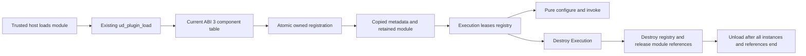

# Native Custom Task and module ownership

Native Tasks use the public `ud_component_descriptor` ABI 3 configure/invoke callbacks, registered in the same registry and run by the same Control Flow core as built-ins. `examples/plugins/custom_task.c` compiles with installed public headers only and links the shared SDK. It evaluates the shared expression AST against native lexical variables and acquires/authorizes a logical connection through the public Connection Manager; it does not create another executor or access private structures.

`ud_plugin_api.components` points to an immutable module-owned `ud_component_plugin_api` table of descriptors. `UD_PLUGIN_COMPONENTS` identifies that role. A component-only module may omit generic initialize/execute/destroy and shutdown; calling `ud_plugin_create` on it returns Unsupported rather than an empty successful factory. Generic/mixed modules retain the existing complete generic factory contract. Components can be registered using `ud_plugin_register_components` without a second library loader or wire/config protocol.

`ud_registry_register_owned` stages copied metadata for every descriptor, validates ABI/category/callbacks and duplicate IDs, and acquires paired owner references. Failure anywhere rolls back all staged entries and references, leaving the registry unchanged. Successful entries hold the module until registry destruction, even before/after an Execution runs. Registry registration/destruction returns Busy while an Execution leases it. `ud_plugin_unload` returns Busy while generic instances, callbacks or registered component references remain. Consequently a terminated Execution cannot leave callback pointers into an unloaded library. Runtime plan copies remain protected by the leased external registry. Hosts serialize module/registry lifetime operations; ownership callbacks do not reenter registry mutation or Execution control.

Only the current complete ABI 3 is accepted. The loader and all bundled providers require the current exact `ud_plugin_api` size and version. Info requests with older version/layout return Incompatible. Old-prefix fallback and legacy fixture modules are excluded under the user's explicit single-version instruction. SDK/plugin callers must rebuild from the current headers. This is a development contract within SDK 1.0.0, not published compatibility with older draft binaries or 0.x.

Loading native code is a trusted host action, not a sandbox or an implicit Package privilege grant. Resource access in the example requires common OPEN/WRITE authorization; missing callbacks/default deny prevent variable/file effects. Optional marker append is an intentionally nontransactional fixture effect on an explicitly granted logical file. Callback resources and parsed expression/config are released on success, error, cancel and deadline. Tasks must not start/wait/destroy their borrowed Execution inside callbacks. `UD_END` and invalid status values from invoke are rejected as Invalid; Busy becomes the shared terminal Transient outcome. Errors and cancellation use normal Control Flow precedence and Package states.

The example declares no replay-safe capability. A real file effect followed by process exit before TaskDone resumes as CommitUnknown without another invoke/effect; completed resume restores variables and skips invocation. The SDK does not infer arbitrary native effects are safe or roll them back. A host may register other descriptors with an explicit replay-safe contract, subject to the same registry/Journal rules.

Tests cover actual shared libraries, invalid second-descriptor rollback, a component-only module without dummy factories, current ABI/version/layout rejection, registry/module/Execution/instance unload guards, native expressions/scopes, default/write denial, readonly/config errors, IO/Busy/END propagation, running cancellation/deadline, and actual effect/crash/Unknown/completed resume. The independent CMake consumer builds the module against installed SDK headers/libraries using `-DUD_BUILD_CUSTOM_TASK_PLUGIN=ON`; the existing Contracts-only function example remains available without that option. Current evidence is under `docs/acceptance/evidence/ssis-custom-task`. Broader G07/G21 plugin categories, language registry exposure and thread-race gates remain separate work; Windows/remote CI gates are waived by user instruction.
