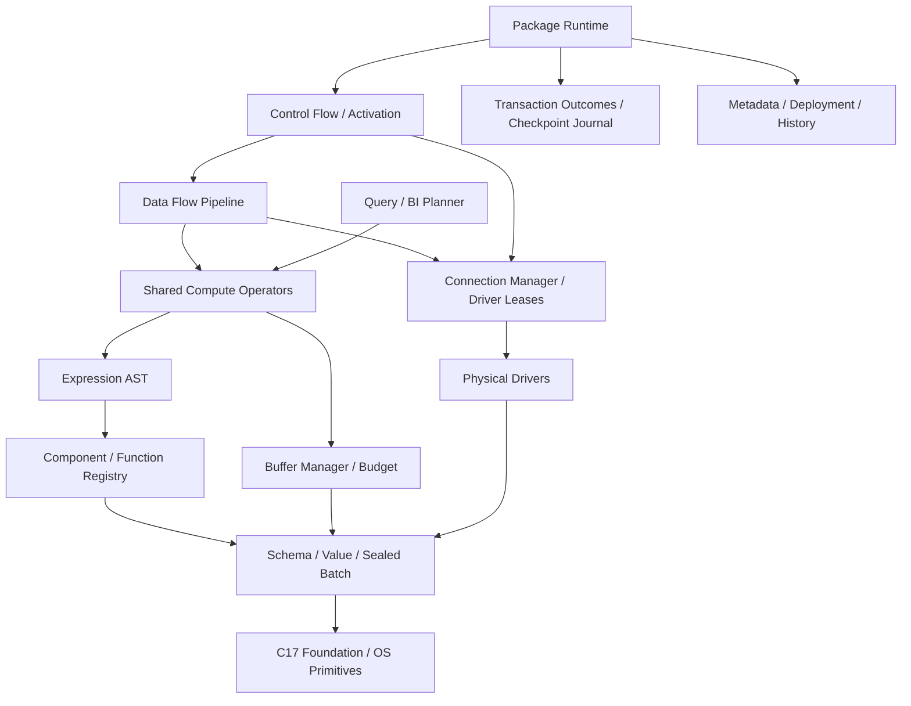

# UniversalData 统一产品架构与 Phase 0–7 实施设计

设计日期：2026-10-12。审查基线：PR #3 的 `902b45d`。本轮允许删除旧 API、协议与实现；只接受一个当前版本族。用户最新验收约定为 **Windows 编译和测试，Linux 免测**。全部阶段源码完成后集中编译与关键验收；历史 Linux 记录不证明本轮代码。

## 产品、职责和边界

产品是纯 C17、可嵌入的 ETL SDK。宿主负责身份、授权、凭据、调度和安装依赖；SDK 负责不可变定义的绑定、执行、资源预算、数据计算及持久化结果。C# 与 Java 只封装同一 C ABI，不解析执行计划、不推导类型、不执行转换。Package 是保存和执行单位，Project 组织 Package、环境和共享连接；一次 Execution 选择一个不可变部署版本。Catalog 保存定义、版本和运行记录。

Control Flow 描述 Tasks、Containers 和 Precedence Constraints；Data Flow 描述 Source、Transform、Destination 和 Paths。DataFlow Task 激活内部 Pipeline，不能单独启动第二个运行时。一个任务失败后可以执行失败处理器，最终失败仍保留。端口结束、任务成功、目标提交、Package 成功是不同事实。

微软公开模型依据：[Package](https://learn.microsoft.com/en-us/sql/integration-services/integration-services-ssis-packages?view=sql-server-ver17)、[Control Flow](https://learn.microsoft.com/en-us/sql/integration-services/control-flow/control-flow?view=sql-server-ver17)、[Data Flow Task](https://learn.microsoft.com/en-us/sql/integration-services/control-flow/data-flow-task?view=sql-server-ver17)、[同步与异步转换](https://learn.microsoft.com/en-us/sql/integration-services/understanding-synchronous-and-asynchronous-transformations?view=sql-server-ver17)、[Checkpoint](https://learn.microsoft.com/en-us/sql/integration-services/packages/restart-packages-by-using-checkpoints?view=sql-server-ver17)、[事务](https://learn.microsoft.com/en-us/sql/integration-services/integration-services-transactions?view=sql-server-ver17)。复用公开职责和运行规则，自行实现代码。任意管道位置的恢复与可嵌入 Catalog 是本产品明示的扩展；不宣称兼容 `.dtsx`、COM、SSISDB 或 MSDTC。

## 源码审查与根因

| 已审查边界 | 当前事实 | 处置 |
|---|---|---|
| `engines/etl`、旧 Job/Dag/Run 公共头及语言类 | 当前分支已经删除 | 继续禁止旧执行入口与迁移别名 |
| `components/data` | 已有 Schema owner、identity/lineage、sealed Batch、wire/Arrow 和值语义；代码版本为 4 | 保留唯一数据模型，补齐消费者，删除文档中的版本 3 声明 |
| `components/expression` | 已有 AST/绑定/常量折叠；只有固定操作符，没有纯函数扩展 | 增加同一 Registry 的函数类别及模块租用；禁止独立函数执行入口 |
| `components/compute` | 集合、分组与文本谓词在本模块；表达式另有 AST | 统一谓词入口为 AST；集合状态与外存归共享 Compute |
| `engines/query/src/external*` | CSV Sort 与 NDJSON Join/Group 各持 spill 文件、预算和算法 | 删除专属外存实现；Query 使用共享算子和 Buffer Manager |
| `engines/data-flow/builtins.c` | Sort/Join/Aggregate 累积完整输入，再生成完整结果 | 删除 Pipeline 私有阻塞缓存，使用共享流式算子 |
| `components/execution` | 队列有界，缺共享块存储 | 增加有界块资源、wire spill、checksum 和清理所有权 |
| `engines/package`、`engines/control-flow` | scope、task/pipeline/component ID、depth 和 child definition 挂在共享 Execution 上 | 改为任务 Activation 拥有可变帧；根 Execution 只持共享服务 |
| `connectors`、`plugins` | 逻辑定义与物理 driver 已分开；实际可选能力只按 driver 声明 | 租用绑定 Activation，授权与能力检查在资源打开之前 |
| `catalog` | 不可变 artifact/deployment/history 已有实现 | 保留元数据职责；事件顺序与终态结果由唯一 Execution 提供 |
| `bindings`、`hosts`、`examples`、`tests` | 使用 native Package，但说明、夹具和 ABI 布局有历史版本残留 | 同批迁移当前布局、消费者与关键验收，删除死入口 |

目前的主要问题是资源和算子归属尚未统一、共享 Execution 可变帧阻碍安全并发、文档及清单与源码不同步。移动目录或增加转发包装不能解决这些根因。

## 模块依赖

Foundation 不依赖上层。Contracts 只有公共描述，Registry 实现依赖 Data；Expression 依赖 Data 和 Registry；Buffer Manager 依赖 Data；Compute 依赖 Expression 和 Buffer Manager。Query 只持绑定/计划及共享算子消费职责，不持第二种值比较、聚合或 spill 格式。Control 和 Pipeline 接受同一 Execution 的 Activation。物理 driver 不调度任务。Catalog 不启动另一个执行器。

## 对象、生命周期及所有权

| 对象 | 生命周期和拥有内容 | 借用内容 |
|---|---|---|
| Project / Package | 创建时复制并验证文档；定义不可变；释放时删除解析树 | 无运行状态 |
| Execution | 创建→Validate→Ready→Running→Draining→终态→Destroy；拥有 Context、根 Activation、Registry 租用、资源管理器、journal 和指标 | 宿主 callback user 活到运行及清理结束 |
| Activation | 每次 task/container/child 调用创建；拥有 lexical scope、逻辑路径、局部 deadline、局部取消及迭代帧 | 根 Execution 的定义快照和服务；父 scope 只读或受显式访问规则限制 |
| Pipeline plan / instance | 纯 Configure 完整绑定之后才 Prepare；所有实例逆拓扑释放一次 | Activation、端口 schema |
| Schema owner | 引用计数；递归字段元数据独立复制；借用 views 活到最后引用释放 | 无可变名称或临时 lineage 指针 |
| Batch / Buffer block | mutable 单 owner；seal 后 retain；projection 借用 sealed 数据并保留其 owner | 调用期间的 scalar views |
| Compute operator | create/bind→push/输入 End→分批 pull→End→destroy；拥有有界状态及 block leases | Schema 快照、函数模块租用、根 budget |
| Connection lease | 能力与授权验证→打开物理资源→操作→关闭；打开失败清理部分状态 | Activation 与宿主 resolver |
| Registry entry | 完整描述复制；模块 retain 与 release 成对；活动租用阻止修改/卸载 | 显式约定的 callback user |
| Journal / Catalog | 单 writer/不可变记录；校验、独占锁、原子发布；不含裸指针 | 根运行身份和序列化值 |

成功 emit 只增加引擎引用，调用方仍负责自己的引用。多播共享 sealed 数据；异步转换拥有新输出。输出 schema 在打开外部资源前确定。失败 create 的输出为 NULL；失败 prepare 自行回滚；成功 prepare 必须由 scheduler dispose 一次。释放、取消和日志失败必须保留真实错误。

## 数据和表达式契约

只使用 `ud_field`、`ud_value`、`ud_batch`。Decimal 保留 precision/scale；Timestamp 值域为 UTC 微秒；递归类型比较验证完整形状。所有分组、Join、Lookup、排序和表达式使用同一 Compare/Hash：NULL 三值逻辑；NULL 不参与普通 Join；NaN 规范化；正负零相等；hash 冲突再 Compare。

identity 是逻辑计划字段标识，独立于名称、数据内容和地址。source 在逻辑命名空间派生；保值转发/排序保留 identity；复制、派生、Join 输出生成新 identity 并保留规范 origins。端口匹配、value domain 匹配、外部 layout 匹配分别明确，不用一个“兼容”判断替代三种关系。wire/Arrow/schema JSON 保留 identity 和 lineage。

谓词和派生只用 native JSON AST。纯函数从同一 Registry 绑定，函数描述给出参数数量、类型推导、NULL 和确定性；不提供连接和外部 I/O 权限。表达式保留 Registry/module 租用到销毁。类型和常量溢出在绑定时报错；求值使用相同核。C#/Java 不重复实现这些规则。

## 调度、线程和资源

一个控制器操作 Execution 的 execute/start/wait/destroy；cancel 与 metrics 可以跨线程。Control 调度 ready Tasks，受 `max_concurrency` 和总预算限制；每个 worker 使用自己的 Activation。不可安全并行的共享变量写、物理事务和非线程安全回调通过绑定规则拒绝或按显式依赖串行。任务局部超时只取消自己的 Activation；根取消传播所有 Activation。事件通过根序列器提供稳定序号，不允许 callback 重入控制器。

Pipeline 按拓扑 Configure，按反拓扑公平调度；每条 Path 一个有界队列。输入 End 恰好一次，输出 End 在所有已发 batch 之后。每次 step 最多每输出一批；输入消费前确认全部输出空间。同步输出共享 sealed 数据；异步边界开启新的执行树。阻塞组件调用共享 Compute state，不能将整个输入累积到 Pipeline 私有 Batch。

Buffer Manager 计量 resident、spill、block 数及输出预算；临时资源必须经宿主明确授权。spill 使用唯一版本的 canonical wire，校验长度、内容 digest 和精确 schema；只清理由该管理器拥有的文件。无磁盘授权或超预算返回 AUTH/RESOURCE，禁止隐式无界缓存。临时目录隔离执行身份并持 writer lock。所有打开的 block/read/output 都纳入 Context 内存预算。

## 事务、恢复和可观察结果

Database write 与 receipt 必须处于同一目标事务；File sink 用 stage→flush→hash→原子发布→journal。跨目标没有隐含全局事务。Package 失败可能包含已提交目标，必须在事件和历史中可见。不能通过重试、默认值或“成功处理错误”覆盖 CommitUnknown。

同一 journal 记录任务、迭代、变量、输入证据、算子/block identity 与目标提交。可确定性重放的管道可以重算，必须核对所有 receipt 和源内容；不能把重算描述为任意算子内存快照恢复。SQL source 无持久 snapshot、外部效果无幂等确认时，绑定拒绝相应恢复模式。中断效果不明进入 RecoveryRequired，停止源确认。旧日志、旧 Package、旧 wire/插件布局直接 Incompatible。

Catalog 的 Project、Environment、Deployment、Package 与 execution history 分开。历史记录身份、状态、结果、计数及提交事实；不得写入凭据、原始配置或行数据。真正的跨目标分布式事务、CDC acknowledgment 和外部 broker 提交必须有相应 driver 实现及故障证据。

## 当前唯一 C ABI

本分支源码已进入 **ABI/Package/Schema/Plan/Wire/Plugin/Worker/Checkpoint 4**；本轮完成这个唯一版本族，不保留 ABI 3 路径。SDK 产品版本保持 `1.0.0` 开发版；SONAME 为 4。完整 public struct 带 size/version，固定宽度计数、显式 UTF8 长度、opaque handles；有布局变化的全部 native driver、JNI、PInvoke、host 和示例一起重编。未知版本及裁剪布局拒绝。

Public 批次、表达式和算子 API 是嵌入式消费接口，不是第二执行状态机。新增生命周期必须有真实资源/模型职责；禁止无语义转发函数。被替代的格式专属 Query 文件执行 API、文本谓词和旧 ABI 示例删除。公共导出不因没有内部调用就判定死代码，但必须有明确的 SDK 能力、安装消费者或组件注册用途。

## 三次设计反思

1. **语义与边界。** 不同源的 Decimal/UTC/NaN keys 可以具有不同 identity，但 Join 必须按 value domain 接受，端口仍按完整 schema 拒绝错位。排序、spill/reload 和 Arrow 不能改变 key equality 或 origins。若表达式或连接器各自推断类型，这条链路不成立，所以绑定和比较必须下沉到 Data/Expression。
2. **失败与资源。** 一次扇出成功一条边、另一条边失败不能丢失所有权或推进源；输入消费前先确认容量。目标已 commit、journal 尚未发布时终止，恢复必须查 receipt/hash。配额不足和临时权限拒绝保持显式失败。由此删除全输入缓存，集中 block 所有权和 commit 事实。
3. **并发与子包。** 两个任务同时运行时，scope/task ID/deadline/child definition 不能写根 Execution。局部超时不应取消兄弟任务；子包参数与变量不能泄露到父包。由此先引入 Activation，再并发调度，而不是给旧全局状态加一把锁后称为并行。

## 实施与验收清单

| Phase | 交付代码边界 | 必要结果 |
|---|---|---|
| 0 | 本文、产品模型、SSIS matrix、删除矩阵 | 对象/职责/所有权/约束和本轮状态可追溯 |
| 1 | Data/Expression/Registry/Compute/Buffer ABI | 唯一类型/AST/比较/hash/资源模型；版本族一致 |
| 2 | Package/Activation/Control | 作用域、容器、约束、局部期限、并发与事件隔离 |
| 3 | Pipeline/执行树/共享算子 | 多端口、backpressure、阻塞 spill、End/cleanup |
| 4 | Connection Manager/注册组件 | 文件/SQL、转换/路由/阻塞/质量共用生命周期 |
| 5 | Journal/Catalog/History | 提交事实、恢复边界、版本和终态历史 |
| 6 | ABI/Bindings/Hosts/安装消费者 | C/.NET/Java 同定义同原生结果；删除旧入口 |
| 7 | 同一 Registry/Compute/driver 的扩展 | BI、分区/window 与各协议按真实能力接入；无占位注册 |

原 69 项 G00–G68 保持逐项可追踪，外部系统和依赖未提供时保留对应 Blocked/未验收状态，不能用本架构设计将其标为实现。Microsoft 专属 artifacts 是明确不兼容边界。源码完成状态与行为验证状态分别记录。

集中 Windows 门禁包括：native 编译、内存所有权/配额/故障清理、实际并发和取消/超时、SQLite 事务及提交回执、真实子进程终止恢复、三语言一致性和独立安装消费。只有相关源码变化、门禁失败或未解决假设才重复检查。Linux 本轮免测；未执行结果不得写 Verified。
