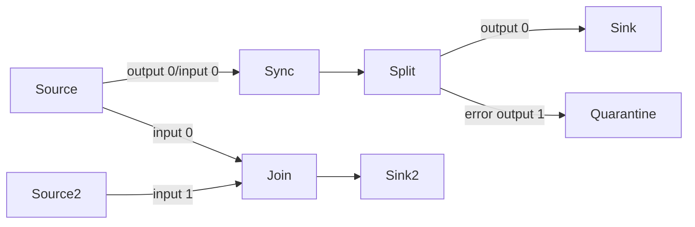

> 前轮设计记录：本轮架构和 API 以 [四引擎目标](../architecture/etl-four-engine-target.md)、[运行决策](../architecture/etl-runtime-decisions.md) 与当前公开头文件为准。当前版本、能力状态和 Linux 验收统一来自 `metadata/product.json`；Windows 本轮豁免。

# Pipeline、端口、Buffer 与调度

组件描述含 ID/version/category/config schema、输入/输出数、端口 Schema、同步输入索引、错误输出、能力/权限与指标。Source 0 输入 1+ 输出；Destination 1+ 输入 0 正常输出（可有 error）；Transform 多输入多输出。Path 显式输出和输入端口；端口连续、类型一致、无环、所有 Source 可达目标，不能用控制优先约束代替 Path。

阶段：Discover/Configure/Validate（无 I/O 副作用）→Prepare（Schema 和预算）→Acquire→PreExecute→Poll/ProcessInput/InputEnd→Drain→PostExecute→Release/Dispose。运行时拥有实例；失败初始化自行回滚，成功打开由引擎清理一次。每输入端口 End 恰好一次，每输出 End 在所有已发数据之后。

统一数据对象为 ud_batch：sealed 不可修改；异步算子创建新 Batch，同步算子可发送同一 sealed 对象。emit 借用调用方 Batch，统一 Block Store 成功保留后，队列持有 block 句柄；消费时借用显式 View，回调结束先释放 View、再释放 block。多播和投影按真实 allocation ownership 去重；驻留不使用 codec/hash，spill 使用唯一 wire 和独立 working quota。

源及异步边界形成 Execution Tree，同步输入沿同一树延伸。各树由共享 Executor 推进，同一树不并行执行自己；单线程也使用相同调度机制。每组件独立 Activation，Step 只读作用域，全图成功 drain 后才按拓扑 Finish。非 thread-safe 描述符使该图通过同一调度器串行执行。

每条 Path 为并发有界队列，下游优先，每次每输出最多一批；调用前确认输出剩余容量。不同输入轮询防饥饿，End 在队列全部数据之后可见。内存、临时文件、working quota、最大行数和 Control/Tree 共享 worker budget 归同一根 Runtime。失败与取消先等待所有工作离开，再回收队列和组件。

轨迹：Source emit→Sync retain→Split 两输出→每目标消费→最后引用释放。取消清空所有队列并 Dispose；不完整文件保留不可见临时名并清理。归属 engines/data-flow、components/execution、components/data/columnar.c。验证多端口、扇出、错序 End、超额、取消、failure cleanup。
