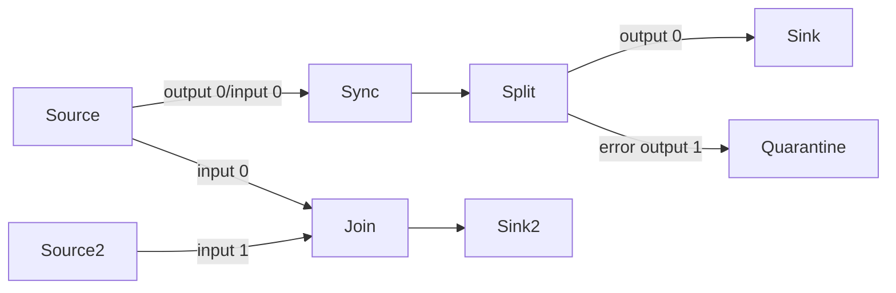

# Pipeline、端口、Buffer 与调度

组件描述含 ID/version/category/config schema、输入/输出数、端口 Schema、同步输入索引、错误输出、能力/权限与指标。Source 0 输入 1+ 输出；Destination 1+ 输入 0 正常输出（可有 error）；Transform 多输入多输出。Path 显式输出和输入端口；端口连续、类型一致、无环、所有 Source 可达目标，不能用控制优先约束代替 Path。

阶段：Discover/Configure/Validate（无 I/O 副作用）→Prepare（Schema 和预算）→Acquire→PreExecute→Poll/ProcessInput/InputEnd→Drain→PostExecute→Release/Dispose。运行时拥有实例；失败初始化自行回滚，成功打开由引擎清理一次。每输入端口 End 恰好一次，每输出 End 在所有已发数据之后。

Buffer 就是 ud_batch：引用计数、sealed 不可修改，异步新 Batch，同步允许同一 sealed Buffer 保留引用并发往输出。共享 Buffer 不支持就地修改；转换要独占可修改 Buffer 必须 clone，不自动做隐式 COW。emit 借用调用方 Batch，引擎 retain 成功后拥有队列引用，调用方释放自身引用。多播不深复制；错用 borrowed 后释放由 ABI 契约与 sanitizer 检查。

每条 Path 有界队列、下游优先、每次每输出最多一批；调用前确认所有输出剩余容量，避免消费输入后 BUSY 丢数据。不同输入轮询防饥饿；阻塞算子持有受配额状态或 spill，End 后分批 drain。内存/临时文件/队列/最大行数/并发预算归同一 Context。不能把 Spill 超限转为无界内存。

轨迹：Source emit→Sync retain→Split 两输出→每目标消费→最后引用释放。取消清空所有队列并 Dispose；不完整文件保留不可见临时名并清理。归属 engines/data-flow、components/execution、components/data/columnar.c。验证多端口、扇出、错序 End、超额、取消、failure cleanup。
