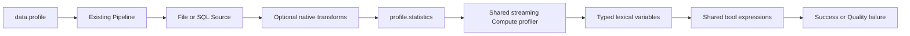

# Data Profiling / Check Task

`data.profile` runs an existing named Pipeline ending at exactly one `profile.statistics` Destination, then evaluates a nonempty list of named bool expression checks. Other Destinations are rejected before I/O, so profiling does not silently write a file/database target. Native Source/Transform components, schemas, Connection Manager, quota, queues, scopes, cancellation and cleanup are the same services used by a Data Flow Task. There is no separate reader or executor.

The Destination takes `statistics`, an array of 1–256 entries containing `kind` (`rows`, `nulls`, `min`, `max`), `variable` and a zero-based `column` for column statistics. Each result targets a distinct writable variable in the nearest lexical scope. Row/null counts are int64; min/max currently support bool/int64/float64/UTF8 and match the field's type. Counts work for any bound column type. Unknown statistics, columns, duplicate outputs and read-only/incompatible variables fail during schema binding. Empty/all-null extrema are typed NULL; empty counts are zero. NULLs do not participate in min/max. Comparisons call the shared Columnar comparator, including the existing float/UTF8 ordering; input buffers are not retained.

`components/compute/src/profile.c` and public `include/ud/profile.h` own streaming state. `ud_profile_add` validates the batch schema and checks cancellation and an optional host/deadline hook each row. The scalar state is bounded by the configured statistic count, except copied UTF8 extrema, which remain charged to the common memory quota. Optional `maximumRows` defaults to INT64_MAX and fails Resource when a batch would exceed it; statistics and counters never spill or grow with row count. A failed add poisons the instance, and get cannot expose a partial result. Destination finish stages all owned values and validates all target bindings before publishing any variable; failures/cancel during scanning or staging leave statistical outputs unchanged. Dispose releases state and copied extrema on every outcome.

Task config requires `pipeline` and `checks` (1–256 `{id, expression}` objects), with optional bool `passedVariable` and int64 `failedChecksVariable`. Check IDs are unique, expression types bind to bool before external I/O, and check outputs cannot alias statistical outputs. After the Pipeline drains successfully, all checks are evaluated using the existing expression AST and current variables. False and SQL UNKNOWN/NULL both fail. The Task publishes the optional pass/failure count and returns Quality if any check fails, allowing ordinary Failure/Completion precedence and event handling. Statistics remain available on a completed scan whose rules fail. An expression evaluation error propagates its native status. The Execution metrics count the profiling Destination's observed rows; a second pipeline reading the same source contributes another read/delivery, not another set of distinct records.

Replay-safe profiling uses the existing Journal. File Sources hash immutable input and restart an interrupted read/scan instead of snapshotting an operator's partial memory. A real process exit mid-scan or after result production but before TaskDone recomputes statistics and checks; a completed Task restores its lexical snapshot and skips the scan. Changed source bytes reject resume. Persistent SQL Source snapshots remain Unsupported, as in the common recovery contract. In checkpoint mode, existing Pipeline validation rejects non-replay-safe external Sources/Transforms; a host's replay-safe capability remains its explicit contract. This is not a persistent SQL snapshot or global exactly-once claim.

The implemented profiles are row/null counts and scalar extrema with expression checks. Distinct values, histograms, candidate/foreign keys, functional dependencies, approximate statistics, wider scalar variable types and a visual profiling UI are separate extensions, not claimed by this Task. No row values or statistical values are implicitly logged in Execution events/history.

`tests/profile.c` verifies streaming ownership, empty values, poisoned failures, row bounds, hook interruption and ABI rejection. `tests/profile_task.c`/`.py` verify actual File/SQLite reads, multiple batches, numeric/UTF8/NULL semantics, multiple rule failures and Failure precedence, pure binding failures, read authorization/revocation, live cancel/deadline, row/memory limits, and actual process termination/recovery. The C/.NET/Java parity fixture executes the same profiling Task and validates its four actual result checks before the existing 10003-row child Pipeline. Current Linux evidence is under `docs/acceptance/evidence/ssis-profile`; Windows/remote CI tests remain waived by user instruction.
