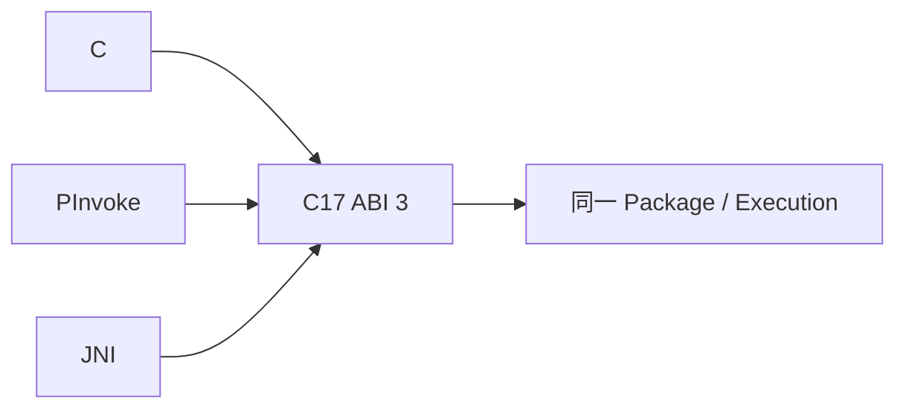

# 公共 C ABI 3

版本：SDK 1.0.0 开发版、ABI/Package/Plugin/Worker/Wire 主版本 3。所有结构以 struct_size、abi_version/version 开头；固定宽度计数、显式长度、opaque handles；callback 指针属于 ABI，内存必须经 ud_alloc/ud_free 或提供的 host API。调用返回 ud_status，诊断关联 ID，不含凭据、原始 SQL 数据/配置秘密。UD_END 是迭代结果，不是失败或 Package terminal 状态。

对象：ud_package（不可变定义）、ud_execution（唯一运行句柄）、ud_registry（统一元数据/回调）、ud_expression（绑定 AST）、ud_batch（引用 Buffer）、ud_connection_manager（运行租用）及 driver lease。销毁 Package/Registry 有活动引用则 BUSY；destroy Execution Running 时 BUSY。字符串 views 借用到对象释放，序列化输出 owned ud_free。线程：一个控制器；cancel/metrics 允许并发；callbacks 执行线程串行，不可重入控制 API。

.NET SafeHandle/IDisposable 和 Java AutoCloseable 仅封装 ABI、UTF8 长度、错误映射、取消/等待。JSON 在 native 绑定，语言层不重写计划/数据转换。native library、JNI、plugin 必须 ABI 同版本。旧 ud_job/ud_dag/ud_run 导出删除，旧版本明确 Incompatible。

轨迹：create Package→bind/create Execution→release user definition reference→start→wait→metrics→destroy→所有 allocations=0。错误 create 输出 NULL、清理全部已分配对象；超时 wait 返回 BUSY，不能误记 Success。归属 include/ud、bindings/dotnet、bindings/java；layout/ownership/invalid-version tests 必需。
