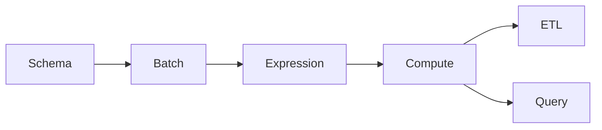

# 类型、表达式和状态契约

类型仍只有 UD_BOOL/INT64/FLOAT64/UTF8/DECIMAL128/DATE32/TIME64/TIMESTAMP/BINARY/STRUCT/LIST/MAP。UTF8 字节长度允许值中嵌入 NUL，标识符/路径/凭据引用禁止 NUL；时间戳值是 UTC 微秒，IANA 信息是字段元数据。Decimal 使用现有 128 位实现、精度/scale 和显式舍入；禁止隐式 float↔decimal。列 ID/Lineage 在 Schema 层携带，复制/转换保留来源集合，Derived 分配新的 ID。

Expression 使用严格 JSON AST（literal/ref/column/op/function），一个 parser/binder/type checker/evaluator。Control 限制只读参数/变量；Pipeline 允许列引用；NULL 与 SQL 三值逻辑一致，UNKNOWN 条件不命中。算术溢出失败，NaN 采用统一 Compare/Hash 的规范形式；类型不匹配拒绝隐式转换。Function Registry 注册纯函数，禁止表达式偷偷执行 I/O。

统一状态：Created→Validating→Ready→Running→Draining→Succeeded；任何非终态可进入 Failed/Cancelled/RecoveryRequired；Ready 可变 Skipped；终态不再执行。State 和 Result 独立：END 只代表一个流结束，不代表 Package 成功；CommitUnknown 代表结果不确定而非可重试。

轨迹：literal null AND false→false；null OR true→true；比较 null→unknown→Split default。不同上下文使用相同 AST。字段不匹配→SCHEMA，整数加法越界→OVERFLOW，取消→CANCELLED。

归属：include/ud/expression.h、execution.h、data.h；components/expression 与 components/compute；tests/expression 和 tests/package。状态转移函数唯一，所有组件使用它。
