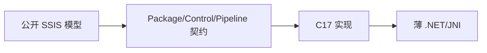

# SSIS 官方证据映射

2026-10-12 阅读微软 SQL Server v17 公开文档；只复用架构与公开语义，未复制示例代码。下列源路径是目标归属，实际实现/验证另见 ssis-status.json。

| 官方入口 | 读取的核心事实 | UniversalData 等价定义 | 复制程度 | 代码归属 |
|---|---|---|---|---|
| [packages](https://learn.microsoft.com/en-us/sql/integration-services/integration-services-ssis-packages?view=sql-server-ver17) | Package 是连接/控制流/数据流/事件/变量/参数的执行保存单位 | Package Definition / Execution | 架构等价（目标，尚未验证行为等价） | `engines/package` |
| [control-flow](https://learn.microsoft.com/en-us/sql/integration-services/control-flow/control-flow?view=sql-server-ver17) | Task/Container/Precedence；容器嵌套；Event Handler 自己有控制流 | Control Graph / nested scope / constraints | 架构等价（目标，尚未验证行为等价） | `engines/control-flow` |
| [data-flow-task](https://learn.microsoft.com/en-us/sql/integration-services/control-flow/data-flow-task?view=sql-server-ver17) | DataFlow Task 包含管道引擎；由管道生成执行计划 | DataFlow Task / Pipeline physical plan | 架构等价（目标，尚未验证行为等价） | `engines/data-flow` |
| [custom-component](https://learn.microsoft.com/en-us/sql/integration-services/extending-packages-custom-objects/data-flow/developing-a-custom-data-flow-component?view=sql-server-ver17) | 统一扩展 Source/Transform/Destination 对象模型 | Component Descriptor / Registry | 架构等价（目标，尚未验证行为等价） | `components/contracts` |
| [asynchronous](https://learn.microsoft.com/en-us/sql/integration-services/extending-packages-custom-objects-data-flow-types/developing-a-custom-transformation-component-with-asynchronous-outputs?view=sql-server-ver17) | 同步输出共享 Buffer；异步定义新列并产生新 Buffer；Sort 等待全部输入 | sealed Batch retain / owned async outputs / execution trees | 架构等价（目标，尚未验证行为等价） | `components/data + engines/data-flow` |
| [connections](https://learn.microsoft.com/en-us/sql/integration-services/connection-manager/integration-services-ssis-connections?view=sql-server-ver17) | 连接服务 Source/Destination/SQL Task；包和项目逻辑作用域 | Connection Definition / Manager / driver lease | 架构等价（目标，尚未验证行为等价） | `connectors` |
| [sources](https://learn.microsoft.com/en-us/sql/integration-services/extending-packages-custom-objects-data-flow-types/developing-a-custom-source-component?view=sql-server-ver17) | Source 0 输入 1+ 输出；连接引用；设计时 metadata 与运行时分离 | Source lifecycle / output schema / manager lease | 架构等价（目标，尚未验证行为等价） | `engines/data-flow` |
| [destinations](https://learn.microsoft.com/en-us/sql/integration-services/extending-packages-custom-objects-data-flow-types/developing-a-custom-destination-component?view=sql-server-ver17) | Destination 1+ 输入、通常零输出、可有 error output；外部 schema 校验 | Destination / error port / commit receipts | 架构等价（目标，尚未验证行为等价） | `engines/data-flow + connectors` |
| [checkpoints](https://learn.microsoft.com/en-us/sql/integration-services/packages/restart-packages-by-using-checkpoints?view=sql-server-ver17) | 失败包可按 checkpoint 重启；变量和容器/事务影响恢复点；不意味着管道任意点恢复 | 统一任务/批次日志；批次恢复是明确扩展而非宣称 SSIS 原行为 | 架构等价；批次恢复为扩展 | `engines/package/checkpoint.c` |
| [transformations](https://learn.microsoft.com/en-us/sql/integration-services/data-flow/transformations/transform-data-with-transformations?view=sql-server-ver17) | 转换包含值更新、路由及新聚合/排序 rowset | 统一 Compute 上的转换类别 | 架构等价（目标，尚未验证行为等价） | `components/compute + plugins` |

边界：一个 DataFlow Task 可容纳多个流，这是微软文档的事实；实现可以先按多个 Pipeline 依次运行，不能声称全部流并行。SSIS checkpoint 不提供任意 DataFlow 批次恢复，UniversalData 的 receipt/batch 日志是明确扩展。`.dtsx`、COM、SSISDB、Agent、专用 SSIS datatype/buffer 二进制均暂不兼容。失败轨迹采用自己的标准错误码而非假冒 HRESULT。
