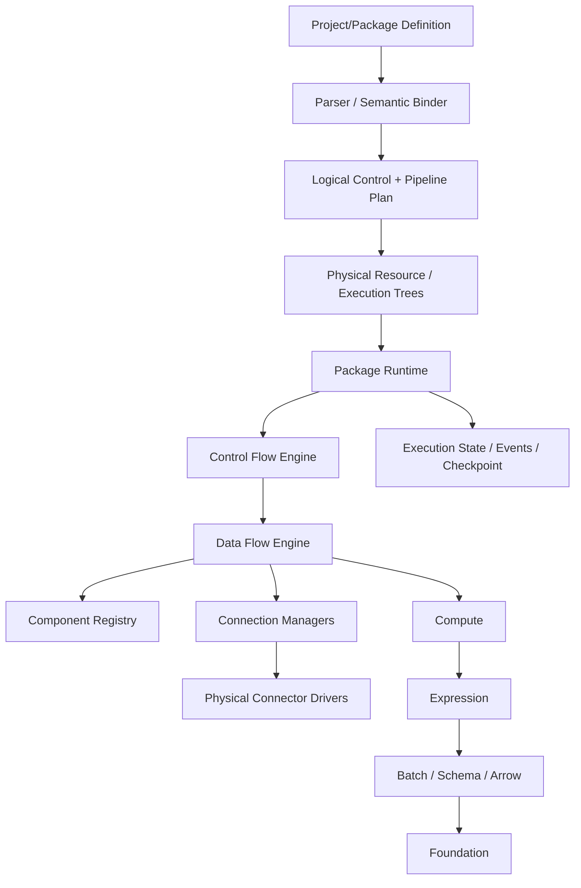

# 目标架构和依赖方向

Package 是唯一启动/等待/取消/结果权威。Control/Pipeline 不再公开独立运行句柄或上下文；它们接受同一 Execution Context。无 ud_job/ud_run 桥接。Columnar、CSV/JSON codecs、Compute 内核及 SQLite/PostgreSQL 驱动保留并原生注册。Query 的集合算法下移 Compute；Query 只绑定/调用共享算子。

engines/package 存 Definition、Binder、Execution、Event、Checkpoint；engines/control-flow 存容器/约束/调度；engines/data-flow 存端口、路径、实例、队列、Execution Tree。connectors 持逻辑连接和物理实例；components/contracts 持统一注册与 ABI 描述；components/execution 只提供共享状态/资源/队列，不再是可启动第二引擎。

轨迹：Package Bind 全部名称/连接/端口/表达式→Prepare 资源→Control 激活 DataFlow Task→Pipeline 按 Execution Tree 和有界队列传递 sealed Batch→目标提交→Task result→Package result。Prepare 不允许写目标。清理按反序，失败不创建成功标记。

迁移门槛：旧 CSV/DAG executor、其公共头与语言入口删除；所有调用方改用 Package；代码搜索不出现旧生命周期；没有旧 API 重定向新 Runtime。阶段中间提交只能留在 draft PR，状态必须明确未完成，不能作为正式双轨架构发布。
