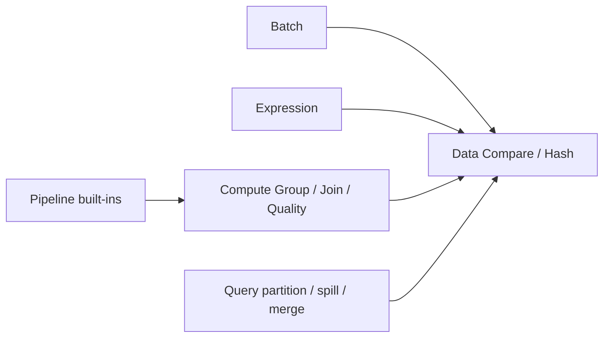

# Shared value comparison and hashing

`components/data/src/semantics.c` owns value ordering and seeded key hashing. Compute, Expression and Query call this implementation; plan/journal/source fingerprints remain cryptographic hashes with their existing protocols.

Values must be validated against matching bound field types, Decimal precision/scale, temporal metadata and recursive shape before comparison or hashing. No cross-type coercion occurs. NULL sorts first; grouping treats NULL keys as equal, while inner Join and foreign-key matching exclude NULL. Ascending float order is `-Infinity < finite values < Infinity < NaN`. All NaN payloads/signs compare equal, and positive/negative zero compare equal. Text and Binary compare bytes with explicit lengths, including embedded NUL. Nested values compare lexicographically, with NULL children using the same rules. Decimal uses its exact signed coefficient at the bound scale; Timestamp uses UTC microseconds.

`ud_value_hash(value, seed)` streams a canonical, typed representation into FNV-1a using little-endian integer bytes, explicit lengths and nested boundaries. Start a key with `UD_VALUE_HASH_SEED`; pass each result as the seed for the next ordered key column. NULL ignores its unused payload, zero has one representation, and every NaN has one representation. Equal valid values under matching schemas therefore have equal hashes for every seed. Collisions always require Compare; a hash is neither identity nor a security digest. Hashing allocates no memory, and callers own cancellation and key traversal budgets.

Batch, Arrow and binary wire retain nonfinite floats. Strict typed JSON/NDJSON emits `"NaN"`, `"Infinity"`, and `"-Infinity"` strings only for nonfinite Float64 values; the declared Float64 field admits exactly these strings and rejects quoted finite numbers, alternative spellings and unquoted JSON nonfinite tokens. CSV and explicit Float64 text parsing use the same three spellings. NaN payload bits can change across text encoding, preserving semantic equality and hash. Float-to-integer conversion rejects nonfinite values. Arithmetic with finite operands still diagnoses overflow; an explicit nonfinite operand propagates IEEE results. SQL drivers must declare their physical type capabilities separately and never silently turn NaN into SQL NULL.

A typical trace binds two Float64 keys, reads `-0` and `+0`, hashes them to the same key, confirms equality, and appends their matches in left-row/right-row order. A second pair with distinct NaN payloads follows the same path. NDJSON spill writes the canonical typed string, rereads a NaN, and selects the same partition. Sort remains stable among equal zeros and NaNs. Unique retains accepted keys across batches; foreign-key comparison uses the same key semantics.

Group/Join/quality allocations use the shared context budget. Allocation failure, cancellation, malformed typed JSON and incompatible key metadata return an error and release owned state. A failed external operation cleans its invocation-owned spill files and does not publish a final dataset. Accumulator snapshots restore key hashes from values, never trusting a persisted hash. Wider Pipeline operator recovery and spill integration remain separate goals and are not established by Query spill tests.

Acceptance is in `tests/value_semantics.c`, the real `typed_external_operators` fixtures, and Package/language regression. Windows execution remains waived by the user.
