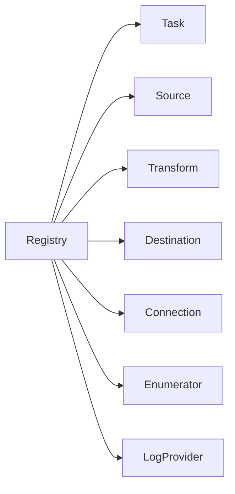

# 组件目录

| 类别 | 目标目录 | 优先级 | 设计 / 实现 / 验证 |
|---|---|---|---|
| Control Flow | DataFlow、ExecuteSQL、Sequence、For、Foreach、Precedence、真正 ExecutePackage | P0 | Implemented 主链；完整门禁分项见 G10–G17 |
| Host tasks | FileSystem、ExecuteProcess、HTTP、Profiling、NativeCustom | P0/P1（权限显式） | Planned / Planned / Planned |
| Sources/Destinations | CSV、JSON/NDJSON、SQLite、PostgreSQL、Error Destination | P0 | Planned / Planned / Planned |
| Row transforms | Cast、Derived、CopyColumn、CharacterMap、ConditionalSplit | P0 | Planned / Planned / Planned |
| Routing | Multicast、UnionAll、Merge、MergeJoin、ErrorOutput | P0/P1 | Planned / Planned / Planned |
| Blocking | Aggregate、Sort、Lookup、Cache、Pivot、Unpivot | P0/P1 | Planned / Planned / Planned |
| Quality | Null、Unique、Range、Regex、Reference、RowCount、Audit、Quarantine | P0/P1 | Planned / Planned / Planned |
| BI | SCD、FuzzyLookup、FuzzyGrouping、TermExtraction/Lookup | P2 | Planned / Planned / Planned |
| Operations | Events、Logs、Checkpoint、Catalog、Deployment、History | P0/P1 | Planned / Planned / Planned |
| Integrations | ODBC/SQLServer、MySQL、HTTP、SFTP、Kafka、RabbitMQ、CloudObjects、CDC、Excel、Parquet/Arrow | P1/P2/可选 | Planned / Planned / Planned |
| Microsoft artifacts | WMI/SMO/SSAS/Agent/OLEDB、dtsx | 可选/暂不兼容 | Planned / Planned / Planned |

所有描述公开 id、name、category、version、config schema、ports、error port、connection requirements、permissions、budget、lineage。同类别未知组件在绑定时 Unsupported；插件可以注册多个类别，生命周期仅由公共 Runtime 执行。P1/P2 分期不在注册表中提供无行为占位。轨迹 Source→Transform→Destination 与 Source→ErrorOutput→Quarantine 共用同一 Path/Scheduler/提交，失败 Dispose/释放租用。代码归属 components/contracts、engines/data-flow、connectors、plugins。

本表保留目标分类，不能用分类整行代替逐项验收；实时状态以 [69 项清单](../acceptance/completion-goal.json) 为准。Execute Package 的规范模型与真实证据见 [子 Package 契约](../architecture/execute-package.md)。

FileSystem 的四种明确文件操作及权限/恢复边界已交付，见 [File System Task](../architecture/filesystem-task.md)；其他 Host tasks 仍按分项清单推进。
