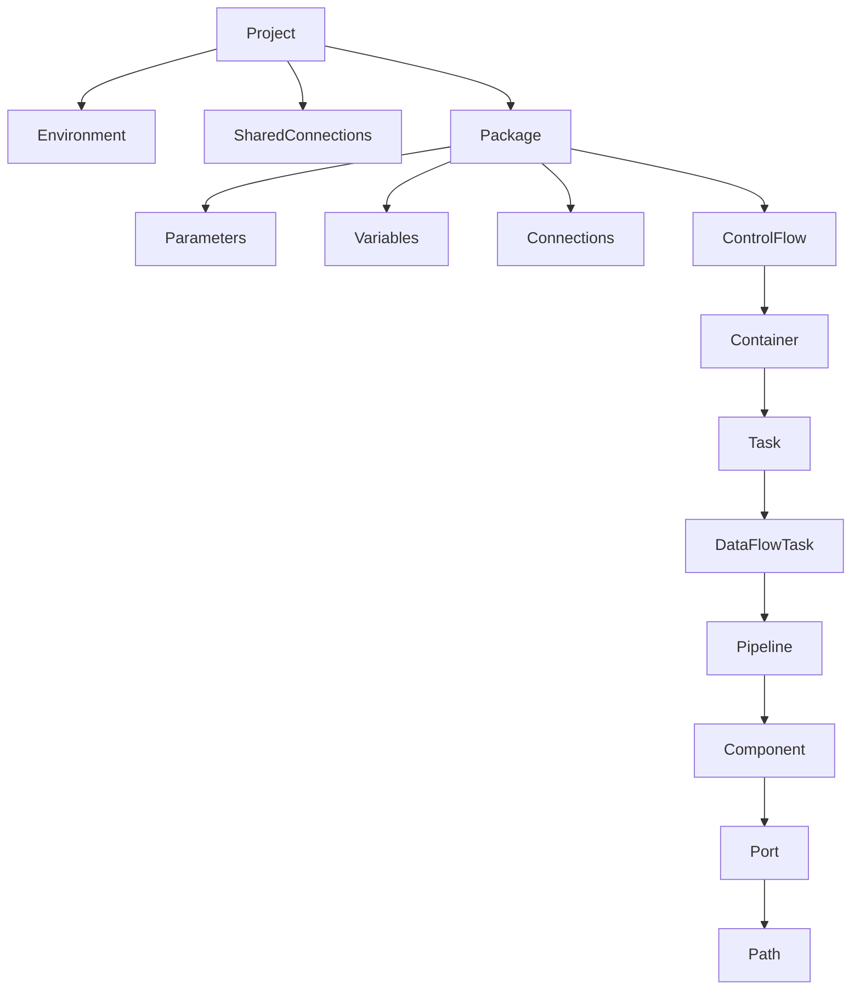

# 唯一产品模型

Definition 是不可变 JSON 文档（version 3）；Project 提供环境、共享连接和 Package 集合。每次 Execution 拷贝参数值并创建资源上下文。Package 不与 Pipeline 共用一张 DAG。ControlFlow 在每个容器内是无环依赖图；循环是容器重复执行自己的控制图，不是循环数据流边。

Package 顶层字段：version、id、parameters、variables、connections、controlFlow、dataFlows、policy、可选 project/deployment 绑定元数据。controlFlow 含 tasks、constraints；task 有 id、kind、config、可选 children/variables。dataFlows 含 id、components、paths；path 显式 from/output/to/input。组件配置引用 connection ID，禁止直接配置密钥。参数/变量由 Project→Package→Container→Task 从内到外查找，局部同名遮蔽，禁止覆盖只读参数；未知名称在绑定时报 SCHEMA。

典型轨迹：参数 tenant/path 绑定→连接定义解析→Sequence→For 迭代→DataFlow Task→Pipeline→目标提交→任务终结→Package 终结。失败事件处理器运行同一控制流模型，但不会覆盖原失败结果。Completion 约束与成功约束不同；未满足约束的节点 Skipped。循环上限、深度、队列、内存预算都是显式策略，超限失败。定义与执行状态分离，不能把上次 Succeeded 写回定义。

归属：include/ud/package.h 定义 Package/Execution ABI；engines/package 模型与绑定；engines/control-flow 管理作用域；engines/data-flow 管理管道。Catalog 只存文档和执行记录，不成为第二执行器。

Project/Environment/Deployment 原生绑定契约及版本选择见 [详细模型](../architecture/project-environment.md)。绑定不增加执行器。
