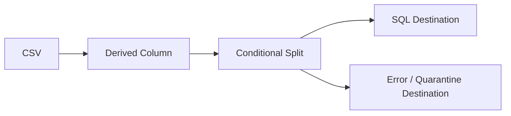

# 场景与可观察结果

1. 嵌入式文件集成：Connection Manager 引用绝对输入路径和新输出路径；For/Foreach 变量绑定到组件配置；CSV/JSON Source 经过 Cast、Derive、Split/Multicast 到文件目标。宿主见同一 Execution ID、任务/组件状态和行数。输出不存在时原子发布；目标存在拒绝覆盖。
2. SQL 增量：Execute SQL 与 SQL Source 引用相同连接定义；SQLite/PostgreSQL 驱动提供游标、写入和回执。一个批次 business write 与 receipt 同事务；目标 CommitUnknown 时不推进源水位。恢复查询回执再决定重放。
3. 插件嵌入：宿主注册 native Task 和多端口转换，公开 ABI 回调生命周期；插件不读取私有结构。Prepare 失败时已获取资源反序释放；取消时每个已打开实例 Dispose 恰好一次。
4. BI 基础：Query 调用 Compute 的 Compare/Hash/Sort/Join/Aggregate；其表达式与 Pipeline 使用同一 AST 和三值逻辑，Query 不拥有 Package 启停状态机。

失败轨迹：授权拒绝→没有外部操作；预算不足→Failed/Resource；某目标已提交而另一个失败→Package Failed，已提交回执可见但不可报告整体成功；恢复能力缺失→Unsupported，不自动重试副作用。

归属与验证：tests/package、tests/pipeline、tests/recovery，三语言 Consumer 使用同一 JSON，不各自解析或实现任务。场景完成状态见 docs/acceptance/ssis-status.json。
